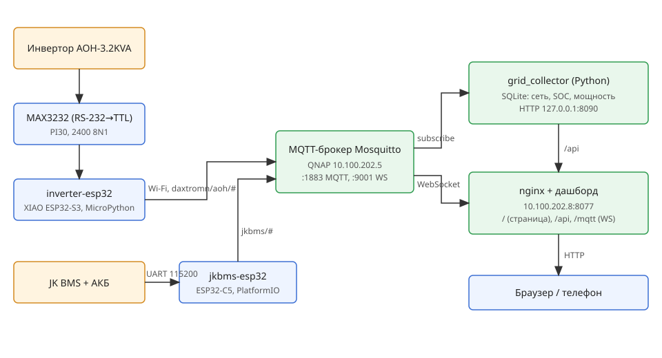

# Daxtromn AOH-3.2KVA + JK BMS — мониторинг через MQTT

Две платы ESP32 публикуют данные в общий MQTT-брокер, один дашборд показывает инвертор и батарею.



```text
Инвертор ─RS-232─ MAX3232 ─ inverter-esp32 ─┐
                                            ├─ Wi-Fi ─ MQTT (Mosquitto) ─┬─ nginx + дашборд (WebSocket)
JK BMS ─UART─ jkbms-esp32 ──────────────────┘                            └─ grid_collector → SQLite → /api
```

## Структура
| Папка | Содержимое |
|---|---|
| `inverter-esp32/` | Прошивка (MicroPython, XIAO ESP32-S3): опрос инвертора по PI30 → MQTT. README, распиновка RJ45, схемы подключения, диагностические скрипты |
| `jkbms-esp32/` | Прошивка (PlatformIO, ESP32-C5): чтение JK BMS → MQTT. Описание подключения, протокол GPS UART, `jk_scan.py` |
| `dashboard/` | Общий веб-дашборд (`index.html`), `collector/` (учёт сети/SOC), конфиг nginx и systemd |
| `mqtt-server/` | Конфиг Mosquitto, ACL, таблица топиков |
| `docs/` | `architecture.svg` (общая схема), протоколы, даташиты, фото, скриншоты, отчёты |

## Секреты (не в репозитории)
Создать локально из примеров:
- `inverter-esp32/config.example.py` → `config.py`
- `jkbms-esp32/include/secrets.h.example` → `secrets.h`
- `dashboard/config.js` (логин `dashboard`, только чтение)
- `dashboard/collector/grid-collector.env.example` → `/etc/grid-collector.env`
- `mqtt-server/passwd` (`mosquitto_passwd`)

Вентиляторный проект (`inverter-fan-esp32s3`) в репозиторий не входит.
